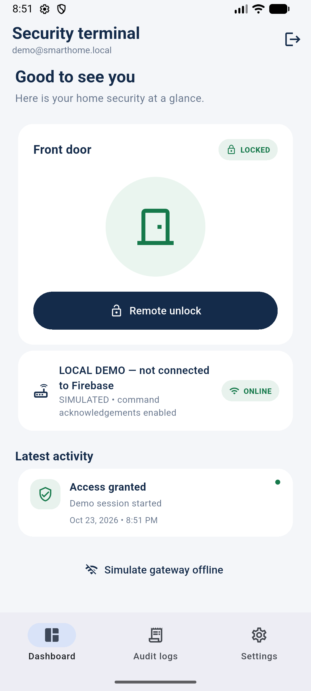
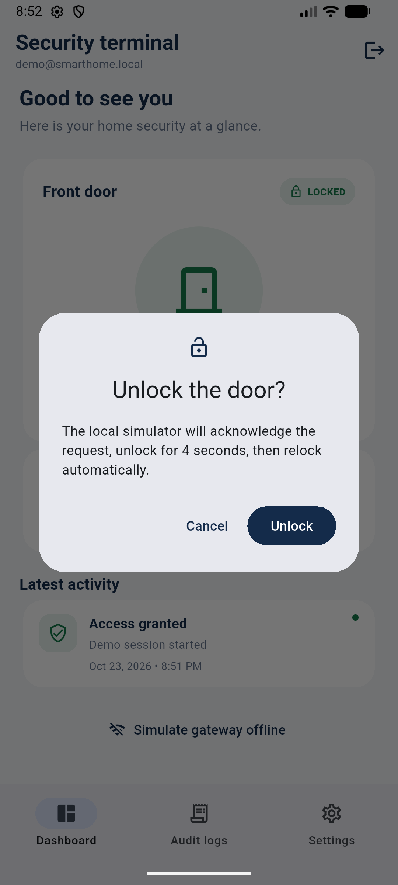
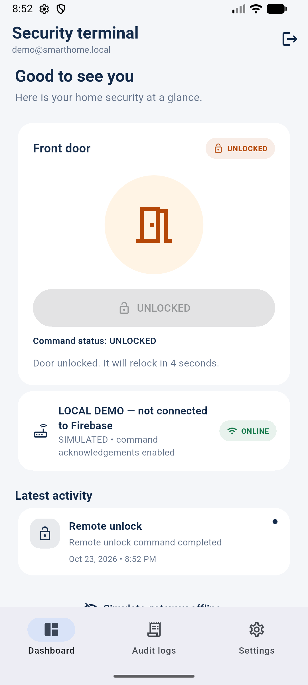
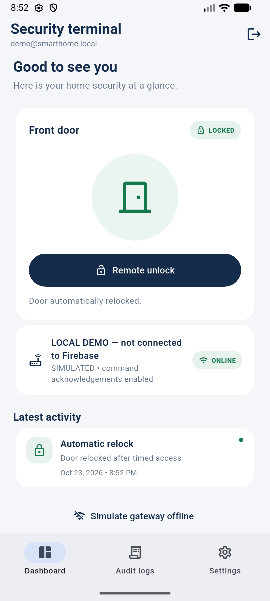
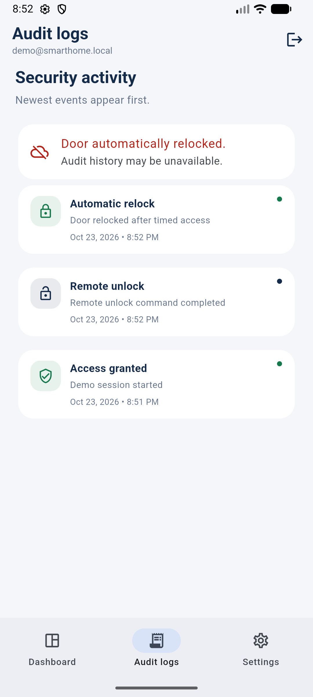

# Final five-minute demo script

This script uses the installed **release APK** in local demo mode. The simulated lock, login, and audit events are not live Firebase or hardware functionality.

## Before the demo

- Use Android Emulator `emulator-5554` (Android 17/API 37) with the release APK installed.
- If needed, install and launch it:

  ```powershell
  $adb = 'C:\Android\Sdk\platform-tools\adb.exe'
  & $adb install -r build\app\outputs\flutter-apk\app-release.apk
  & $adb shell monkey -p IoT_SmartHome.Security 1
  ```

- Do not use live administrator credentials, create a Firebase account, or connect a physical device during this demonstration. The app initializes Firebase Core with the configured project at startup and includes Firebase Analytics; local mock mode prevents app Auth/Realtime Database operations, but passive telemetry has not been ruled out.
- A separate Milestone 5.2 check verified administrator sign-in and one read-only door-state path. It did not test remote unlocking; keep this presentation in local demo mode.

## Timed presentation

### 0:00–0:25 — Project introduction

“This is an IoT Smart Home Keypad Security Terminal prototype. It combines an administrator dashboard, an authenticated remote-command design, and a keypad lock architecture. Today I will demonstrate only the local software simulation.”

### 0:25–0:50 — Custom Flutter application

Show the custom Flutter sign-in screen, navigation, status badges, and event cards. Mention the shared service interface supports separate mock and Firebase-backed implementations.

### 0:50–1:20 — Authentication

Point out that Firebase email/password authentication and an administrator-UID check are implemented. A controlled Milestone 5.2 test verified the approved administrator sign-in and a read-only door-state read; no isolated Auth Emulator is wired to the Flutter app. For this presentation, **do not sign in or create an account**. Choose **Try local demo mode** instead; identify `demo@smarthome.local` as a local mock identity, not a Firebase user. Be clear that this avoids app Auth and Realtime Database operations, but does not guarantee the Firebase SDK emits no passive telemetry.

### 1:20–1:50 — Dashboard

Show **LOCKED**, then point to **LOCAL DEMO — not connected to Firebase** and **SIMULATED**. Explain the state is supplied by the in-app mock service, not a door sensor or database.



### 1:50–2:20 — Remote unlock simulation

Tap **Remote unlock** and show the confirmation dialog. Read its message that the local simulator will acknowledge the request, unlock for four seconds, then relock. Confirm **Unlock**.



### 2:20–2:45 — Automatic relocking

Show the **UNLOCKED** status and four-second message, then wait for **Door automatically relocked** and **LOCKED**. No physical actuator is connected.





### 2:45–3:10 — Audit logs

Open **Audit logs** and point out **Remote unlock** and **Automatic relock**. Explain these are local mock events. The not-connected warning is expected because demo mode has no database connection.



### 3:10–3:45 — Arduino/ESP32 integration architecture

Describe the **proposed, unverified** flow: Flutter administrator app → Firebase Auth/Realtime Database → ESP32 Wi-Fi gateway → level-shifted UART → Arduino Uno lock controller. The Uno is intended to own keypad PIN checking, three-attempt/30-second lockout, servo timing, LCD, and buzzer; the ESP32 is intended to handle Wi-Fi, Firebase identity, command delivery, and audit synchronization. The ESP32 Firebase client is still a stub, and no physical hardware was tested.

### 3:45–4:20 — RAD methodology

Summarize the four Rapid Application Development phases: requirements planning (security and low-cost scope), user design (Flutter screens and demo mode), rapid construction (Firebase contract, simulator, virtual keypad tests), and cutover (still pending live deployment review, hardware bring-up, provisioning, and acceptance testing).

### 4:20–4:45 — Low-cost approach

Explain that Flutter/Dart, Node's built-in test runner, Android Emulator, and Firebase Emulator Suite were used to exercise the software without purchasing hardware or adding paid services. Emulator tests validate rules and simulated behavior, not production service behavior.

### 4:45–5:00 — Limitations and close

State the boundary plainly: this presentation used local demo mode. A separate M5.2 check verified administrator authentication and read-only door state, but no remote command or physical keypad/servo/ESP32 test was performed; the APK uses debug signing. Invite feedback without representing the prototype as a production security device.

## Release-mode evidence

- [Login screen](./screenshots/01-release-login.png)
- [Dashboard](./screenshots/02-release-dashboard-demo.png)
- [Unlock confirmation](./screenshots/03-release-unlock-confirmation.png)
- [Unlocked state](./screenshots/04-release-unlocked.png)
- [Automatic relock](./screenshots/05-release-relocked.png)
- [Audit logs](./screenshots/06-release-audit-logs.png)
- [Settings navigation](./screenshots/07-release-settings.png)
- [Logout returning to login](./screenshots/08-release-logout-login.png)

Settings navigation and logout were exercised on the release build; screenshots are included as evidence. The app does not provide a keypad UI, so PIN lockout is demonstrated only by automated virtual-hardware tests.
